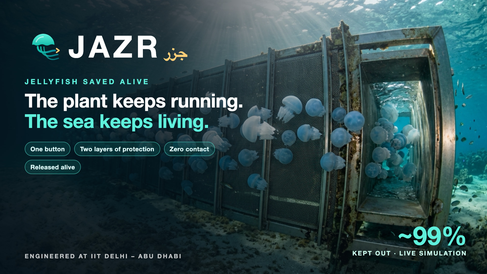

<p align="center">
  
</p>

<h1 align="center">JAZR | جَزْر</h1>
<p align="center"><b>The plant keeps running. The sea keeps living.</b><br>
A one-button response to jellyfish blooms at coastal nuclear-plant seawater intakes: guide, lift and return the jellyfish to the sea alive.</p>

<p align="center">
  <a href="https://jazr.vercel.app"><b>🌐 Website</b></a> ·
  <a href="https://jazr.vercel.app/3d/"><b>🧊 Live 3D twin</b></a> ·
  <a href="https://jazr.vercel.app/dashboard/"><b>🖥️ Bloom Incident OS</b></a> ·
  <a href="media/pitch.mp4"><b>▶ Pitch film</b></a> ·
  <a href="media/tour.mp4"><b>▶ Narrated 3D tour</b></a> ·
  <a href="media/JAZR_Proposal_10slides.pdf"><b>📄 Proposal deck</b></a>
</p>

<p align="center"><i>ATRC Advanced Technology Pioneers 2026 · ENEC track · Engineered at IIT Delhi – Abu Dhabi</i></p>

---

## In one minute

When the jellyfish early-warning alert arrives, the operator presses **one button**. In about **10 minutes** JAZR deploys in every intake lane:

| # | Stage | What it does |
|---|---|---|
| ! | **Bloom Incident OS** | Auto-deploys on the alert, with operator veto. Hard-wired interlocks. AI is advisory only and air-gapped. |
| 1 | **Layer 1: moving-belt angled screen (11°)** | The mesh belt runs along the face, so bells ride to the apex and nothing sticks. |
| 2 | **Apex + flared entrances** | Draw 15–35% of lane flow, so velocity always rises toward the bypass. |
| 2b | **Layer 2: hydro-jet curtain, no air** | Low-velocity water jets lift any leaker to a surface skimmer. No bubbles: air under the bell kills jellyfish. |
| 3 | **Flat-plate dewatering** | Returns surplus water. No sharp edges. |
| 4 | **Turtle-excluder grid (~15 cm)** | Small Gulf bells pass. Turtles and big bells take an open escape chute, alive. Camera + sonar 2-of-3 backup. |
| 5 | **HydroLift** | Water-only float chambers. The animals rise with the water and nothing touches them. |
| 6 | **Head tank + dissolved O₂ → 1.6 m gravity pipe** | No bubbles, no pumps in the animal path. Runs through the breakwater, trenched. |
| 7 | **10-day drift forecast** | Picks the Near (5 km out) or Far (~10 km alongshore) outlet, so released animals don't drift back. |
| ✓ | **Released alive** | Submerged diffuser ≤1 m/s, temperature and salinity matched. |

The plant's own screens are untouched. **Shear-pin passive relief** means any failure returns to today's plant, never worse.

## Results (model-based)

| | Today | With JAZR |
|---|---|---|
| Share of the bloom reaching the plant screens | **100%** | **~1%** (0.4% best case) |
| Real-current hindcast, 292 alert windows | 71% | 6.2% (earlier design) |
| Released alive | none | **76–98%** (two estimates; target ≥95%) |
| Crew-hours per bloom | baseline | **−60% to −90%** |
| Energy | – | ≈0.03% of plant output |

**Evidence:**
- About 600 engineering checks and **112 automated tests**, all passing.
- 900/900 bells guided in the virtual tank.
- The browser twin stays within 1.4 points of the Python model.
- Control logic was model-checked: 26,633 states, deadlock-free.

**Honest status:** every result is computational or literature-based. No physical prototype exists yet. The next step is the pre-registered tank test.

## What's in this repository

```
index.html               Landing page (deployed site)
3d/                      Cinematic 3D digital twin (three.js): BEFORE vs WITH JAZR, every stage, live "saved alive" counter
dashboard/               Bloom Incident OS: 14-tab control-room HMI, with a live browser simulation in dashboard/sim/
shared/                  Evidence bundle + procedural textures used by the 3D twin
media/                   Films, proposal deck, cover, screenshots and renders
engineering/
  design/JAZR_v5_FINAL.md   Locked design: every element and the test that decided it
  twin/                     Python digital twin (jazr_twin.py) + studies and outputs
  tests/                    11 test streams + master report (00_TEST_REPORT.md)
     00_data                 Real Gulf currents, waves, SST, wind, jellyfish and turtle records
     01_twin_VV              Twin verification & validation (pytest 54)
     02_hydraulics_structures Screen sizing, head loss, loads, bypass, pipe, energy, materials
     03_cfd_flow             2D CFD of the angled screen
     04_biology_wildlife_ops Biology, wildlife, FMEA, operations (pytest 16)
     05_economics_risk       Economics, risk, regulatory (pytest 19)
     06_physical_protocols   Pre-registered protocols: 16 tank, 8 flume and 5 pilot tests, with data sheets
     07_virtual_tank         Simulated tank tests T01–T16
     08_controls_extremes_FEA FEA, seismic, extremes, model-checked controls, cyber, LCA (pytest 23)
     09_biology_behaviour    Jellyfish behaviour and survival
     10_mechanisms           Belt, dewatering, HydroLift and O₂ mechanisms
     11_eta_max_sims         Guidance-maximisation sweeps (30 seeds)
```

## Run it yourself

```bash
# Website, 3D twin and dashboard (any static server)
python3 -m http.server 8000      # then open http://localhost:8000

# Python twin + tests
pip install numpy scipy matplotlib pytest
cd engineering/tests/01_twin_VV && pytest -q              # 54 passed
cd ../04_biology_wildlife_ops && pytest -q                # 16 passed
cd ../05_economics_risk && pytest -q                      # 19 passed
cd ../08_controls_extremes_FEA && pytest -q               # 23 passed
```

## No-harm charter

No live animal is killed. The system uses no nets, acoustics or electric fields, and puts no bubbles in the animal path. O₂ stays at 75–99% saturation. Temperature and salinity are matched at release. Turtles always have an exit where they can reach air. Outlets sit away from reefs, beaches and other intakes. Dead-on-arrival animals go only to beneficial reuse.

## Team · IIT Delhi – Abu Dhabi

- **Lakshan Muruganandam**
- **Tarunika Ravikumar**
- **Shouq Alhosani** (UAE national)

AI use is declared in [AI_DECLARATION.md](AI_DECLARATION.md).

<sub>© 2026 Team JAZR, IIT Delhi – Abu Dhabi. All rights reserved. Shared for evaluation in ATRC Advanced Technology Pioneers 2026. No real plant's internal data was used; all inputs are public data or stated assumptions.</sub>
