<p align="center">
  
</p>

<h1 align="center">JAZR | جَزْر</h1>

<p align="center"><b>The plant keeps running. The sea keeps living.</b></p>

<p align="center">A one-button, no-harm response to jellyfish blooms at coastal nuclear-plant seawater intakes.<br>
After the early-warning alert, JAZR guides the bloom away from the plant's screens, lifts it without touching it, and returns the jellyfish to the sea alive.</p>

<p align="center">
  <a href="https://jazr.vercel.app"></a>
  <a href="https://jazr.vercel.app/3d/"></a>
  <a href="https://jazr.vercel.app/dashboard/"></a>
</p>
<p align="center">
  
  
  
  
  
</p>

<p align="center"><i>ATRC Advanced Technology Pioneers 2026 · ENEC track · Engineered at IIT Delhi – Abu Dhabi</i><br>
<b>Lakshan Muruganandam · Tarunika Ravikumar · Shouq Alhosani</b></p>

---

## Contents
1. [Try it in 30 seconds](#-try-it-in-30-seconds)
2. [The problem](#-the-problem)
3. [The JAZR system](#-the-jazr-system)
4. [How it works, step by step](#-how-it-works-step-by-step)
5. [What is new](#-what-is-new)
6. [Results](#-results)
7. [No harm by design](#-no-harm-by-design)
8. [The digital prototype](#-the-digital-prototype)
9. [The test programme](#-the-test-programme)
10. [How the tests changed the design](#-how-the-tests-changed-the-design)
11. [Feasibility and regulation](#-feasibility-and-regulation)
12. [Key assumptions and limitations](#-key-assumptions-and-limitations)
13. [How we will test it if shortlisted](#-how-we-will-test-it-if-shortlisted)
14. [Repository map](#-repository-map)
15. [Run it yourself](#-run-it-yourself)
16. [Proposal deck and gallery](#-proposal-deck)
17. [Team](#-team)

---

## ⚡ Try it in 30 seconds

| | What | Link |
|---|---|---|
| 🌐 | **Website**: everything in one place | **https://jazr.vercel.app** |
| ▶ | **Pitch film** (1:52) | [jazr.vercel.app](https://jazr.vercel.app) → *Watch the pitch* · [MP4](media/pitch.mp4) |
| 🎬 | **Narrated 3D tour** (1:56) | [MP4](media/tour.mp4) |
| 🧊 | **Live 3D digital twin**: BEFORE vs WITH JAZR, every stage, live "saved alive" counter | https://jazr.vercel.app/3d/ |
| 🖥️ | **Bloom Incident OS**: 14-tab control-room dashboard | https://jazr.vercel.app/dashboard/ |
| 📈 | **Live simulation**: the browser twin | https://jazr.vercel.app/dashboard/sim/ |
| 📄 | **Proposal deck** (10 slides) | [PDF](media/JAZR_Proposal_10slides.pdf) |

**In the 3D twin:**
- Press **Deploy** and watch the belt cassettes lower in about 10 minutes of plant time.
- Press **S** for the split view (Today vs JAZR) or **Tour** for the guided stops.
- Use the clock slider to speed time up.

<p align="center">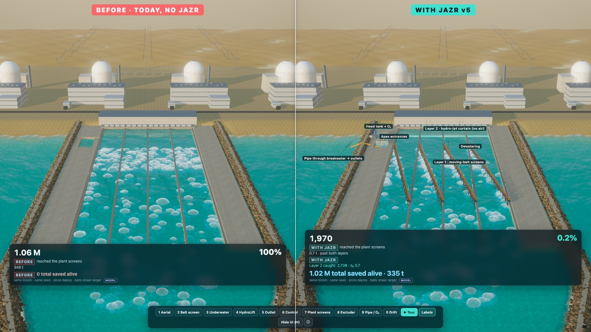</p>
<p align="center"><sub>Same bloom, same random seed. Left: today, the whole bloom reaches the plant screens. Right: with JAZR.</sub></p>

---

## 🌊 The problem

Seasonal jellyfish blooms drift onto coasts and can choke a power plant's seawater intake within hours. The plant then has to cut output or trip, even when an early warning arrived in time.

- **91 jellyfish intake incidents in 19 countries and territories** are catalogued in our review; 81 of 91 rows are verified, 68 at a primary source:
  - **Hanul, Korea 2021:** the net tore, the reactor tripped, and over 400 t were removed by hand.
  - **Ohi-4, Japan 2024:** 17 screen baskets bent and a cooling pump was off for 6 weeks.
  - **Hongyanhe, China 2014 & 2023:** units shut down or cut.
  - **Az-Zour, Kuwait 2017:** pumps paused for several days.
- **Today's answer is still boats, nets and crews.** A boat handles about **1 t/h**, while one unit's bloom arrives at about **108 t/h** with about **100 m³/s** of cooling water. That is ≈2,600 t/day, more than Hongyanhe's whole 2023 season (2,420 t).
- **What existing alternatives offer:**
  - Bubble curtains have no published plant performance data, and air trapped under a bell kills jellyfish.
  - Shredding robots have never passed field trials, and they kill.

**The warning exists. The response doesn't.** JAZR is that response.

---

## 🧩 The JAZR system

<p align="center">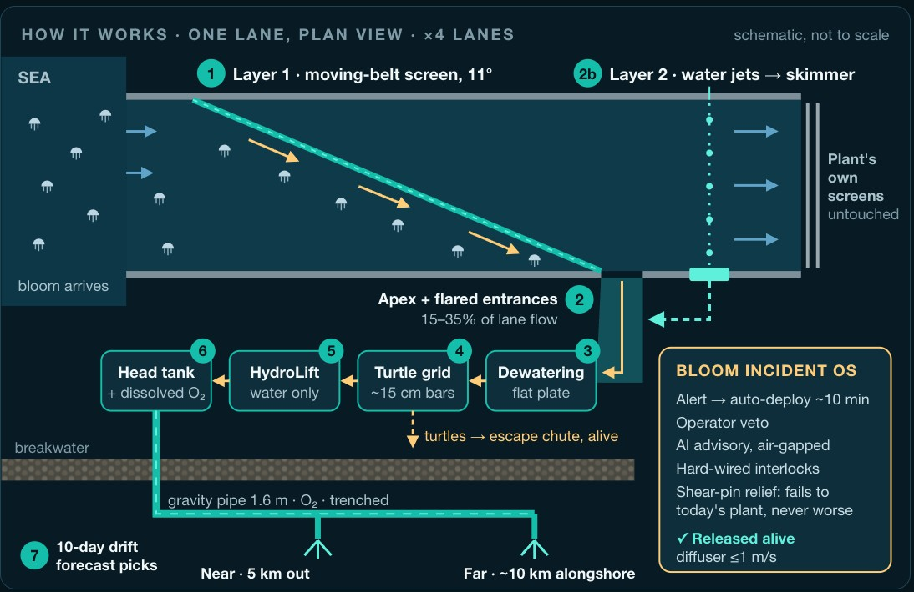</p>

```mermaid
flowchart LR
    A[Early-warning alert] --> OS[Bloom Incident OS<br/>auto-deploy ~10 min<br/>operator veto]
    OS --> L1[1 · Layer 1<br/>moving-belt angled screen 11°]
    L1 --> AP[2 · Apex + flared entrances<br/>15–35% of lane flow]
    L1 -. leakers .-> L2[2b · Layer 2<br/>hydro-jet curtain, no air<br/>to surface skimmer]
    L2 --> AP
    AP --> DW[3 · Flat-plate dewatering]
    DW --> TG[4 · Turtle-excluder grid ~15 cm]
    TG -- turtles, big bells --> ESC[Escape chute: sea, alive]
    TG --> HL[5 · HydroLift<br/>water-only float chambers]
    HL --> HT[6 · Head tank + dissolved O₂<br/>1.6 m gravity pipe]
    HT --> FC{7 · 10-day drift forecast}
    FC -- Near --> N[Outlet 5 km offshore]
    FC -- Far --> F[Outlet ~10 km alongshore]
    N --> R[Released alive<br/>diffuser ≤1 m/s]
    F --> R
    L1 -. clean water .-> P[Plant's own screens<br/>untouched]
```

**Key properties:**
- Four independent lanes, one per unit.
- The plant's own screens are untouched.
- Shear-pin passive relief plus hard-wired interlocks: **any failure returns to today's plant, never worse.**
- The AI is advisory only and air-gapped (FANR-REG-08 / IEC 62443).

---

## 🔁 How it works, step by step

| # | Stage | What it does | Why it is built this way |
|---|---|---|---|
| ! | **Alert → Bloom Incident OS** | Auto-deploys on a red alert with operator veto. Gantry winches lower belt cassettes in about 10 min. No crane, no boats. | Late alerts: two approvals gave 5% in time vs 59% with auto-deploy (tests/04) |
| 1 | **Layer 1: moving-belt angled screen (11°)** | The mesh belt runs *along* the face toward the apex at 0.5–1.0× sweep, so bells ride it and nothing sticks. Silicone non-stick mesh, bays ≤4.8 m, stored dry out of season. | Virtual tank: belt guidance 1.00 in every case. Precedent: Bates 1970, 97–100% of fish diverted (tests/07, 10, 11) |
| 2 | **Apex + flared entrances** | Draw 15–35% of lane flow, half to the apex; velocity always rises toward the bypass; graded baffles and a light wall jet. | CFD: the apex entrance takes reach from 0–74% to 100% (2D) (tests/03) |
| 2b | **Layer 2: hydro-jet curtain, no air** | Low-velocity floor and wall jets lift any leaker to a surface skimmer feeding the same collector. | Bubble curtain rejected: air under the bell kills jellyfish (AZA husbandry) |
| 3 | **Flat-plate dewatering** | Returns surplus water to the lane; bells ride over a smooth plate with no wedge-wire edges. | Removes the sharp-edge injury path (tests/10) |
| 4 | **Turtle-excluder grid (~15 cm)** | Small Gulf bells (6.5–12 cm) pass. Turtles and large bells slide alive to an open escape chute. Camera + sonar 2-of-3 backup. | Camera-only protection = kill in the virtual tank (tests/07) |
| 5 | **HydroLift** | 2–3 open water-only float chambers: animals rise with the water and nothing touches them. Only screened water is pumped. | Screw blade contact 13–24% per pass for real bell sizes (tests/10) |
| 6 | **Head tank + O₂ → gravity pipe** | Dissolved oxygen in a side-stream (no bubbles), dosed by biomass. A 1.6 m ID pipe runs through the breakwater, trenched, following NMFS bypass-pipe rules. | A pump trip pulls a vacuum and the pipe floats in shallow water, hence gravity flow and a trench (tests/02) |
| 7 | **10-day drift forecast** | Picks Near (5 km offshore) or Far (~10 km alongshore, down-drift). | Typical onshore drift 2.5 cm/s: near-only gives 50% return in a 10-day bloom, far gives 10–13% (twin) |
| ✓ | **Released alive** | Submerged diffuser ≤1 m/s, temperature and salinity matched, away from reefs, beaches and other intakes. | No-harm charter |

<table>
<tr>
<td width="50%">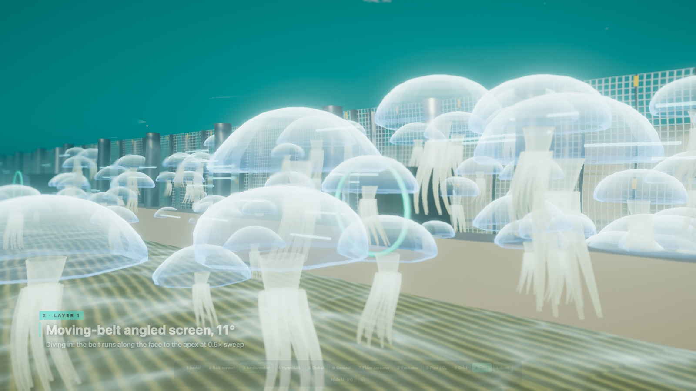<br><sub>1 · Bells ride the moving belt to the apex</sub></td>
<td width="50%">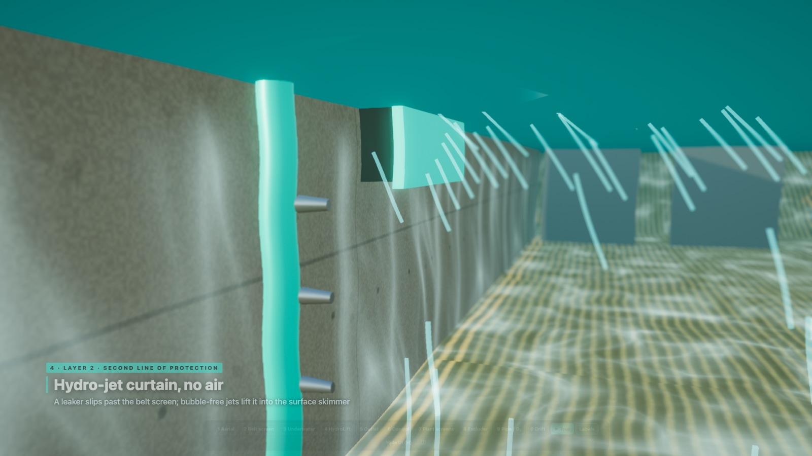<br><sub>2b · Layer 2 hydro-jets lift leakers to the skimmer</sub></td>
</tr>
<tr>
<td>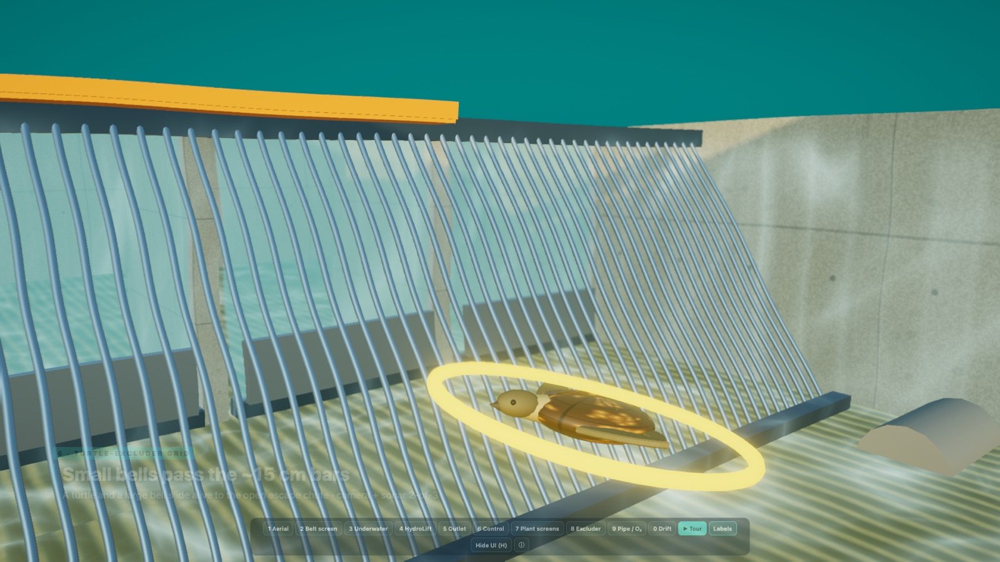<br><sub>4 · A turtle takes the escape route at the excluder grid</sub></td>
<td>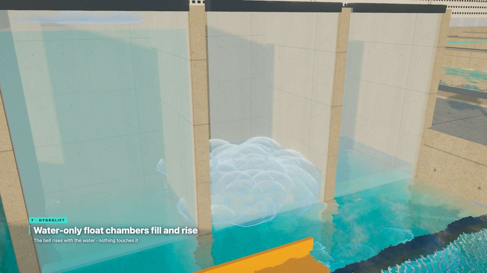<br><sub>5 · HydroLift: animals float up with the water</sub></td>
</tr>
<tr>
<td>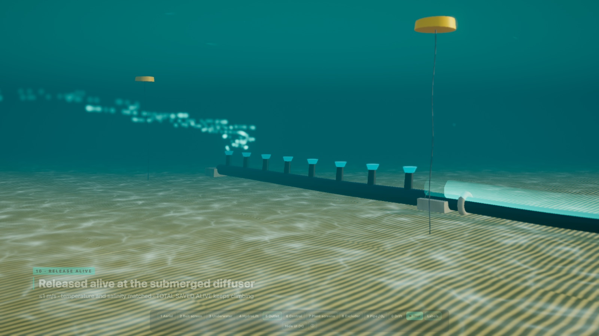<br><sub>✓ Released alive at the submerged diffuser</sub></td>
<td>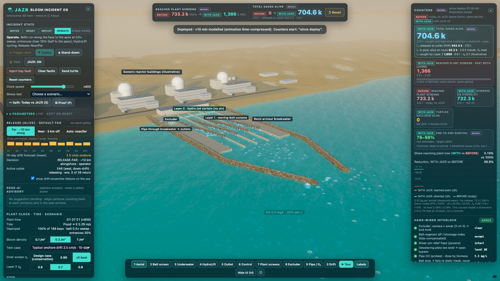<br><sub>The whole intake, every element labelled</sub></td>
</tr>
</table>

---

## 💡 What is new

| Typical approach | What happens |
|---|---|
| Screens + crews | Overload: Ohi-4 bent 17 baskets |
| Booms, nets, boats | Nets tear (Hanul trip); a boat ~1 t/h |
| Bubble curtains | No plant data; air under the bell kills |
| Robots / shredders | Never past field trials; lethal |
| **JAZR** | **Continuous, crew-light, no killing: animals released alive** |

No plant anywhere reports releasing jellyfish alive. JAZR combines proven parts in a way nobody runs today:

1. **A moving belt along the screen face.** Bells ride to the apex and nothing sticks: 900/900 guided in the virtual tank.
2. **Layer 2 without air.** Water jets do what bubble curtains can't do safely.
3. **HydroLift.** A water-only lift: no screws, no buckets, no contact.
4. **Forecast-chosen live release.** A 10-day drift forecast decides where animals go, so the bloom doesn't come back.
5. **A model-checked fail-safe and the Bloom Incident OS.**
   - The control logic was model-checked across **26,633 states** and is deadlock-free.
   - Safety comes from shear-pin relief, 2-of-3 voting and hard-wired interlocks.
   - The AI only advises.

---

## 📊 Results

*All results are model-based (simulation, engineering calculation, real public data, literature). No physical prototype exists yet.*

<p align="center">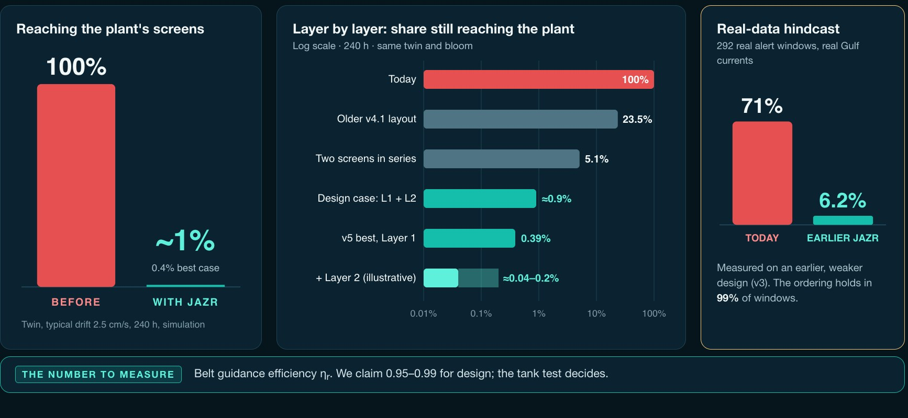</p>

**Share of the bloom reaching the plant screens** (twin, far release, typical drift 2.5 cm/s):

| Configuration | 72 h | 240 h |
|---|---|---|
| Today, no system | 97% | **100%** |
| Older v4.1 layout (η_r ≈ 0.77) | 22.4% | 23.5% |
| Two screens in series | 4.9% | 5.1% |
| η_r = 0.99 | 1.1% | 1.15% |
| **v5 best combination** (η_r lower bound 0.996) | **0.36%** | **0.39%** |
| v5 + Layer 2 (η₂ 0.5–0.9, illustrative, untested) | ≈0.04–0.18% | ≈0.04–0.2% |
| **Conservative design case** (η₁ 0.97 + η₂ 0.7, used in the dashboard) | ≈0.9% | **≈0.9%** |

| Headline | Value |
|---|---|
| Kept off the plant screens | **~99%** (≈0.9% reach in the design case; 0.4% best case) |
| Released alive | **76–98%**: two independent estimates; design target ≥95% |
| Crew-hours per bloom | **−60% to −90%** |
| Time to deploy | **~10 min**, one button |
| Energy | **≈0.03%** of plant output |
| Real-current hindcast (292 alert windows, earlier design) | Today 71% → **6.2%**; the ordering holds in 99% of windows |
| Virtual tank (30 seeds) | **900/900** bells guided; η_r = 1.000 (95% lower bound 0.996) |
| Output protected per avoided unit-day of outage | **~32 GWh** |
| CO₂ avoided per avoided unit-day of outage | **≈13,000 t** |

**Guidance held under every stress case:**
- rheotactic 10 cm/s swimmers;
- friction μ 0.4;
- a fouled bay;
- 1 bell/m³;
- a stopped belt.

With the belt stopped, the other levers alone still stack 0.82 → 0.97 → 0.992. Neither model has 3-D leak paths (seals, bay joints), so **for design we claim η_r ≈ 0.95–0.99**. The tank decides.

---

## 🐢 No harm by design

<p align="center">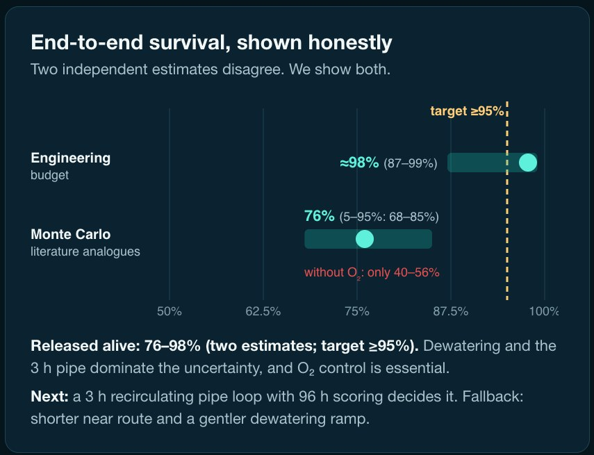</p>

**The no-harm charter is non-negotiable:**
- No live animal killed.
- No nets, acoustics or electric fields.
- No bubbles in the animal path.
- O₂ held at 75–99% saturation, with no supersaturation.
- Temperature and salinity matched at release.
- Turtles and large bells always have an exit where they can reach air.
- Outlets sit away from reefs, beaches and other intakes.
- Dead-on-arrival animals go only to beneficial reuse.
- Fish in the bypass are released alive with the jellyfish.

**End-to-end survival is shown honestly as two estimates:**
- **Engineering budget:** ≈**0.978** (plausible 0.87–0.99).
- **Conservative Monte Carlo** from literature analogues: **0.76** (5–95%: 0.68–0.85). Without O₂ it is only 0.40–0.56.
- Both agree that dewatering and the 3 h pipe dominate the uncertainty, and that **O₂ control is essential**.
- The decisive experiment is a 3 h recirculating pipe loop scored over 96 h. If it misses the ≥95% target, the fallback is a shorter Near route and a gentler dewatering ramp.

**Ecology:**
- No light guidance; the site stays dark at night.
- Polyp mitigation: dry storage, no overhangs, settlement plates.

---

## 🖥️ The digital prototype

ENEC asked for *"a basic prototype, simulation, or model, and not simply … a concept."* JAZR ships three working pieces of software, live in any browser with no install.

### 1 · Cinematic 3D digital twin: [`3d/`](3d/) · [open live](https://jazr.vercel.app/3d/)

- **Scene:** the whole intake in three.js. It shows the belt screens, apex entrances, Layer 2 jets, dewatering, excluder, HydroLift, head tank, pipe, the drift-forecast ribbons and both outlets.
- **Controls and views:**
  - **BEFORE vs WITH JAZR** split view: same bloom, same seed.
  - A live **TOTAL SAVED ALIVE** counter.
  - A guided **Tour** in exact process order.
  - Fault injection (bay fault, turtle), a stress-test menu, and a parameters drawer.
  - A clock-speed slider and Reset.

<table>
<tr>
<td width="50%">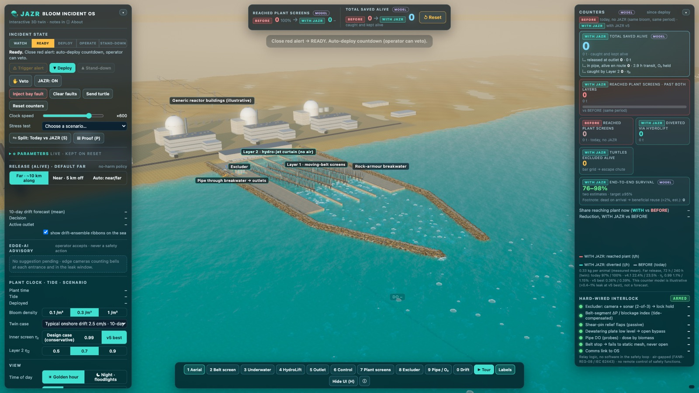<br><sub>Incident state: watch → ready → deploy → operate</sub></td>
<td width="50%">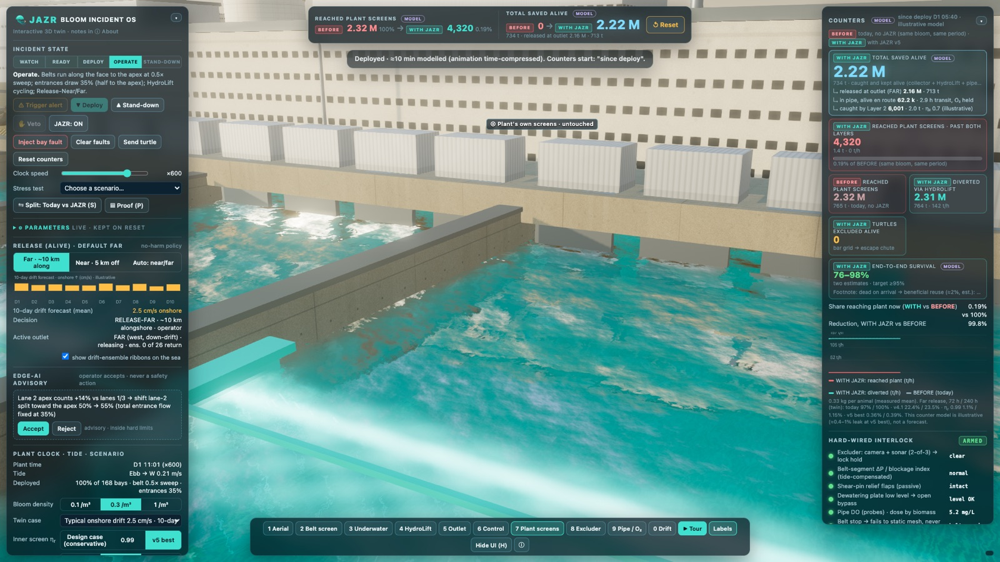<br><sub>Live counters: saved alive, reached plant, turtles excluded</sub></td>
</tr>
</table>

### 2 · Bloom Incident OS: [`dashboard/`](dashboard/) · [open live](https://jazr.vercel.app/dashboard/)

A control-room HMI with 14 tabs:

| Tab | What it shows |
|---|---|
| **Main Dashboard** | Incident state machine, alert panel, hard-wired interlocks, process mimic (4 lanes × 42 belt bays + Layer 2), alarms (ISA-18.2), AI advisory with Accept/Reject, KPI strip |
| **Simulation** | The live browser twin |
| **Screens** | Bay-by-bay blockage index, belt speed, η per lane |
| **Bypass & Lift** | Entrances, dewatering, excluder, HydroLift cycles |
| **Release** | Drift forecast, Near/Far decision, outlet status, return risk |
| **Wildlife** | Turtle events, camera + sonar 2-of-3 voting |
| **Biology** | O₂, temperature, salinity, survival budget |
| **Alarms** | ISA-18.2 alarm list, shelving, acknowledgement |
| **Trends & Analytics** | Diverted vs reaching intake, blockage, O₂ |
| **Evidence** | Every chart built from the test-result files |
| **Compliance** | FANR / EAD / IEC 62443 checklist |
| **Maintenance** | Predictive maintenance, belt wear, fouling |
| **Reports** | Incident report generator |
| **3D Simulation** | The 3D twin embedded |

<p align="center">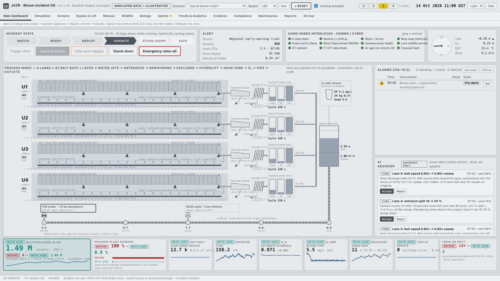</p>

### 3 · Live simulation: [`dashboard/sim/`](dashboard/sim/) · [open live](https://jazr.vercel.app/dashboard/sim/)

- **What it is:** a JavaScript port of the Python twin, running in Web Workers.
- **What you can do:**
  - Set the guidance η, release policy, bloom length, drift, wind, swim speed and density.
  - Run Monte Carlo replicates and an η_r sweep.
  - Export CSV or PNG.
- **Validation:** checked against the Python model on 16 cases, with a worst difference of **1.4 percentage points** ([`validate.js`](dashboard/sim/validate.js)).

---

## 🧪 The test programme

**About 600 computational checks and 112 automated tests, all passing.** Simulated "physical" tests are labelled SIMULATED. Every number traces to a folder in [`engineering/tests/`](engineering/tests/). The master report is [`00_TEST_REPORT.md`](engineering/tests/00_TEST_REPORT.md).

| # | Stream | Checks | Result | Automated tests |
|---|---|---|---|---|
| [00](engineering/tests/00_data) | Real data: currents, waves, SST, wind, jellyfish, turtles | 10 assumptions | 6 OK, 4 changed the design | — |
| [01](engineering/tests/01_twin_VV) | Twin verification & validation | 10 test families | Analytic within 0.7%; converged; 23/23 rows reproduced | **pytest 54/54** |
| [02](engineering/tests/02_hydraulics_structures) | Hydraulics & structures | 300 | 180 pass · 43 marginal · 77 fail (many deliberate stress cases) | `run_all.py` |
| [03](engineering/tests/03_cfd_flow) | CFD of the angled screen | 5 tests | Screen sweep at 11° ✔; mass error ~1e-13; outer line 0–14% (dropped) | — |
| [04](engineering/tests/04_biology_wildlife_ops) | Biology, wildlife, FMEA, operations | 41 | 12 pass · 11 marginal · 8 fail · 9 info | **pytest 16/16** |
| [05](engineering/tests/05_economics_risk) | Economics, risk, regulatory, compliance | 19 tests + 14 permit items | 19 pass; 2 permits PASS, 11 RISK | **pytest 19/19** |
| [06](engineering/tests/06_physical_protocols) | Physical test protocols (pre-registered) | 16 tank + 8 flume + 5 pilot | Data sheets ready | — |
| [07](engineering/tests/07_virtual_tank) | Virtual tank (SIMULATED T01–T16) | 16 protocols × ≥3 runs | 7 pass · 5 fail (+1 kill: turtle, camera only) | — |
| [08](engineering/tests/08_controls_extremes_FEA) | FEA, seismic, extremes, controls, human factors, LCA, climate | 81 | 48 pass · 12 marginal · 15 fail (4 rejected alternatives) | **pytest 23/23** |
| [09](engineering/tests/09_biology_behaviour) | Jellyfish behaviour and survival | — | O₂ budget, phototaxis, polyps | — |
| [10](engineering/tests/10_mechanisms) | Mechanisms: belt, dewatering, HydroLift, O₂ | — | Belt 1.00; screw contact 13–24% | — |
| [11](engineering/tests/11_eta_max_sims) | Guidance maximisation (30 seeds) | — | 900/900 guided | — |

**Disciplines covered:**
- **Flow and structures:** CFD, FEA and modal analysis, fatigue, seismic, extreme events and the 2085 climate.
- **Control and safety:** model-checked control logic (26,633 states), cyber, human factors, FMEA/FTA.
- **Uncertainty and environment:** LCA, Sobol/Morris sensitivity, Monte Carlo.
- **Operations and money:** operations discrete-event simulation, economics Monte Carlo, the regulatory checklist.
- **Testing and real data:** the virtual tank, the pre-registered physical protocols, and a real-data hindcast over 292 alert windows.

**The failures are kept on purpose.** Each one changed the design, as the next section shows.

---

## 🔧 How the tests changed the design

| Finding | Source | Design change |
|---|---|---|
| Roll-up cleaning lets 18–29% through; drum wrap overstresses the mesh | 08, 07 | Angled **travelling-belt** screens |
| Guidance depends on entrance flow (3% → 0.30; 20% → 0.73; 35% → 0.82) | 07, 02 | Entrances draw more lane flow, with **dewatering** |
| The apex entrance decides guidance (100% with it vs 0–74% without, 2D) | 03 | **Mandatory apex entrance**, wider mouths, graded baffles |
| The outer guide line is only 0–14% effective with turtle gaps | 03 | Outer line **dropped** |
| Typical onshore drift is 2.5 cm/s | 00 | **Far alongshore release**, chosen by forecast |
| Real bells are 0.33 kg and 6.5–12 cm; Gulf species mostly *C. perezi* | 00 | Loads 2–9× smaller; **turtle-excluder grid** now possible |
| Camera-only turtle protection = kill | 07, 04 | Excluder grid + camera/sonar 2-of-3 + escape chute |
| Screw blade contact is 13–24% per pass | 10 | **HydroLift** water-only chambers |
| Air under the bell kills | 09 | **Layer 2 uses water jets, not bubbles**; O₂ dissolved, not bubbled |
| A pump trip pulls a vacuum; the pipe floats | 02 | **Gravity** head tank → pipe through the breakwater, trenched |
| 10 m bays release 2.1 t pulses; 0.22 m/s at low tide | 02, 08 | Bays ≤4.8 m; sized at low tide and maximum flow |
| A fixed 200 Pa trip is unreliable; comms-loss and motor-only fail-open fail | 02, 08, 04 | Compensated blockage index, wave filter, shear-pin passive relief, 2-of-3 voting, hard-wired interlock |
| Duplex steel corrodes at 36–39 °C | 02, 08 | Titanium / Cu-Ni / polymer wetted parts |
| Late alerts: two approvals give 5% in time | 04 | Auto-deploy with operator veto |
| Cyber unspecified (9/13 items) | 08, 05 | FANR-REG-08 / IEC 62443 plan, air gap |
| The real event rate is unknown | 05 | **JAZR Core first** (software + one-lane pilot) |

---

## 🏗️ Feasibility and regulation

- **The parts are proven:**
  - angled fish screens;
  - NMFS bypass-pipe rules (R/D ≥5, no valves, no free fall, always full, never sub-atmospheric);
  - gravity pipes and shear pins.
- **Engineering checks:**
  - structure, 60-year fatigue and 0.3 g seismic all pass;
  - energy ≈0.03% of plant output;
  - titanium, Cu-Ni and polymer wetted parts;
  - cooled electronics.

**Regulatory:**
- FANR / operator modification review, seismic and cyber;
- an **EAD permit amendment for live release** (the highest risk);
- a marine-works permit;
- no autonomous craft.

| Risk | Mitigation |
|---|---|
| Belt guidance at scale | The tank test decides; design claim 95–99% |
| Survival below 95% | Shorter Near route, gentler dewatering ramp |
| Live-release permit | EAD engaged early; outlets away from reefs |
| Unknown event rate | JAZR Core first: software + one-lane pilot before full build |

---

## 📐 Key assumptions and limitations

No dataset was provided and no ENEC facility design was used; **every input is public data or a stated assumption**.

**Assumed**
- 4 independent lanes, ~100 m³/s per unit, ~108 t/h of bloom per unit at stress load.
- Bells 6.5–12 cm, mean 0.33 kg (Oct–Nov Gulf data, mostly *Catostylus perezi*).
- Typical onshore drift 2.5 cm/s (stress 5–6 cm/s).
- Alert lead time ≥10 min.
- The plant's own screens and pumps are unchanged.

**Limitations**
- All results are model-based. **No physical prototype has been tested yet.**
- The CFD is 2D. Neither guidance model includes 3-D leak paths (seals, bay joints).
- Layer 2 efficiency η₂ is illustrative and untested.
- End-to-end survival is uncertain (0.76–0.98).
- The plant's real event rate is unknown, and live release needs an EAD permit.

**What only real tests can settle:**
- η_r of the moving belt at scale;
- live-animal survival through the lift and pipe, scored over 96 h;
- the excluder with real turtles;
- drift-back at sea (drifters);
- Gulf depth distribution, O₂ and heat limits;
- fouling and wear over a season.

---

## 🧭 How we will test it if shortlisted

| Step | What | Settles |
|---|---|---|
| **1 · Tank test** (next) | Live surrogate bells, one stage at a time; 3 h recirculating pipe loop with 96 h scoring | Belt guidance, survival |
| **2 · Flume** | Full chain in real flow | Excluder with real turtles, mesh friction |
| **3 · One-lane pilot** | JAZR Core: OS + twin + forecast + one lane, real bloom season | Field η_r, drift-back, operations |
| **4 · Rollout** | All four lanes, only after the pilot proves it | — |

All the protocols are **pre-registered** in [`PROTOCOLS.md`](engineering/tests/06_physical_protocols/PROTOCOLS.md): 16 tank, 8 flume and 5 pilot protocols, each with a data sheet.

**At Demo Day**, visitors can trigger an alert, press deploy and watch the jellyfish released alive in the live 3D twin, while the Bloom Incident OS runs alongside.

---

## 🗂️ Repository map

```
index.html                         Landing page (deployed at jazr.vercel.app)
3d/                                Cinematic 3D digital twin (three.js)
dashboard/                         Bloom Incident OS: 14-tab control-room HMI
  sim/                             Live browser twin (Web Workers) + validate.js (16 cases)
shared/                            Evidence bundle + procedural textures
media/
  pitch.mp4 · tour.mp4             Films (MP4)
  hls/                             Adaptive streams (1080p / 720p / 480p) for instant playback
  preview/                         Silent preview loops for the landing page
  shots/ · renders/                3D screenshots and concept renders
  JAZR_Proposal_10slides.pdf       Proposal deck
engineering/
  design/JAZR_v5_FINAL.md          Locked design: every element and the test that decided it
  twin/                            Python digital twin (jazr_twin.py) + studies and outputs
  tests/                           11 test streams + master report (00_TEST_REPORT.md)
     00_data                       Real Gulf currents, waves, SST, wind, jellyfish, turtle records
     01_twin_VV                    Twin verification & validation           (pytest 54)
     02_hydraulics_structures      Screen sizing, head loss, loads, bypass, pipe, energy, materials
     03_cfd_flow                   2D CFD of the angled screen
     04_biology_wildlife_ops       Biology, wildlife, FMEA, operations      (pytest 16)
     05_economics_risk             Economics, risk, emissions, regulatory   (pytest 19)
     06_physical_protocols         Pre-registered protocols: 16 tank · 8 flume · 5 pilot
     07_virtual_tank               Simulated tank tests T01–T16
     08_controls_extremes_FEA      FEA, seismic, extremes, model-checked controls, cyber, LCA (pytest 23)
     09_biology_behaviour          Jellyfish behaviour and survival
     10_mechanisms                 Belt, dewatering, HydroLift and O₂ mechanisms
     11_eta_max_sims               Guidance-maximisation sweeps (30 seeds)
```

---

## ▶ Run it yourself

```bash
git clone https://github.com/lakshanmuruganandam/jazr.git && cd jazr

# Website, 3D twin and dashboard (any static server)
python3 -m http.server 8000          # open http://localhost:8000

# Python twin + automated tests
pip install numpy scipy matplotlib pytest
cd engineering/tests/01_twin_VV            && pytest -q   # 54 passed
cd ../04_biology_wildlife_ops              && pytest -q   # 16 passed
cd ../05_economics_risk                    && pytest -q   # 19 passed
cd ../08_controls_extremes_FEA             && pytest -q   # 23 passed
```

---

## 📄 Proposal deck

The 10-slide proposal: [**JAZR_Proposal_10slides.pdf**](media/JAZR_Proposal_10slides.pdf)


### Gallery

<table>
<tr>
<td width="33%">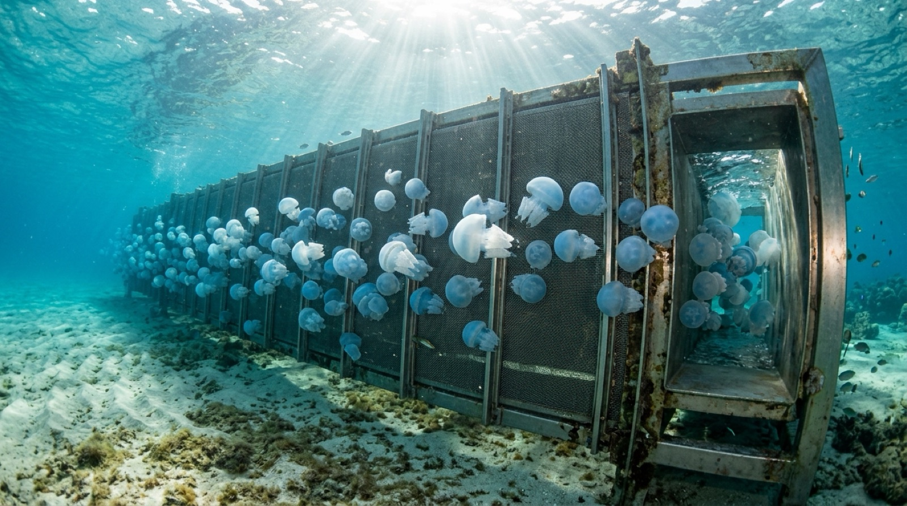<br><sub>Layer 1, underwater</sub></td>
<td width="33%">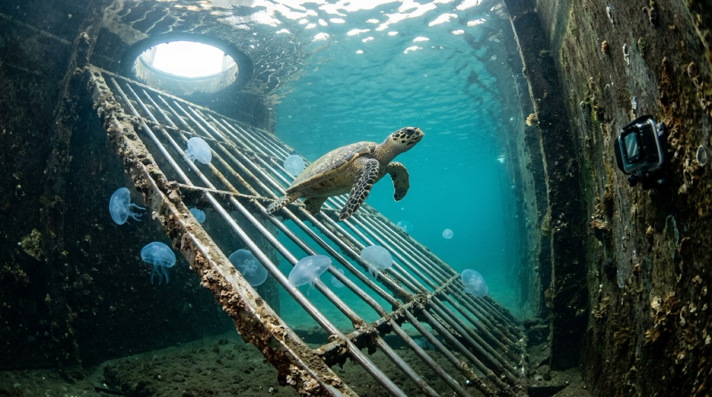<br><sub>Turtle-excluder grid</sub></td>
<td width="33%">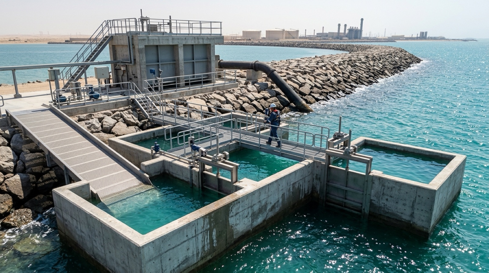<br><sub>HydroLift</sub></td>
</tr>
<tr>
<td>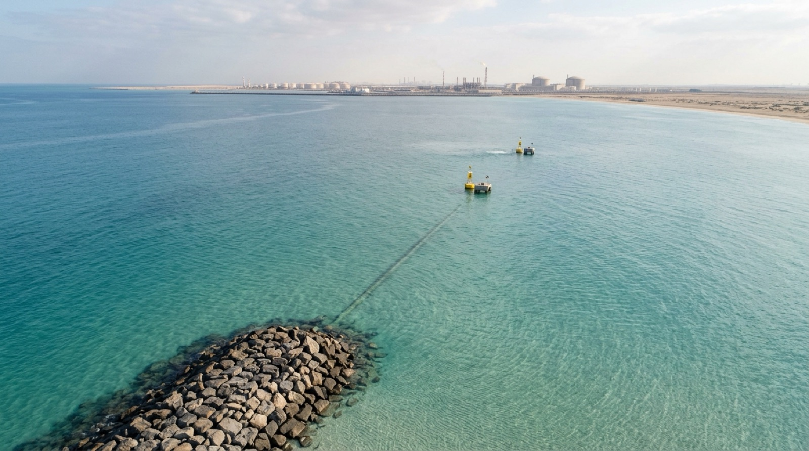<br><sub>Pipe to the outlets</sub></td>
<td>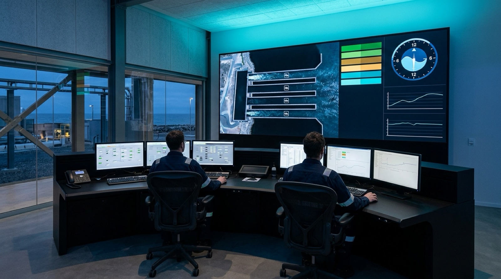<br><sub>Control room</sub></td>
<td>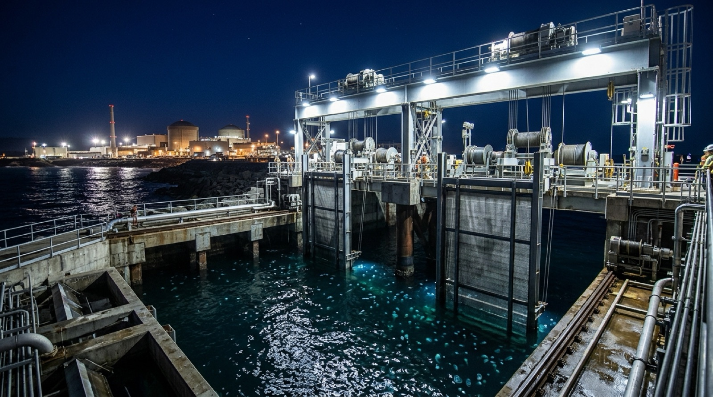<br><sub>Night deployment</sub></td>
</tr>
</table>

---

## 👥 Team

**IIT Delhi – Abu Dhabi**

- **Lakshan Muruganandam**
- **Tarunika Ravikumar**
- **Shouq Alhosani** (UAE national)

AI use is declared in [AI_DECLARATION.md](AI_DECLARATION.md).

<sub>© 2026 Team JAZR, IIT Delhi – Abu Dhabi. All rights reserved. Shared for evaluation in ATRC Advanced Technology Pioneers 2026. No real plant's internal data was used; all inputs are public data or stated assumptions.</sub>
